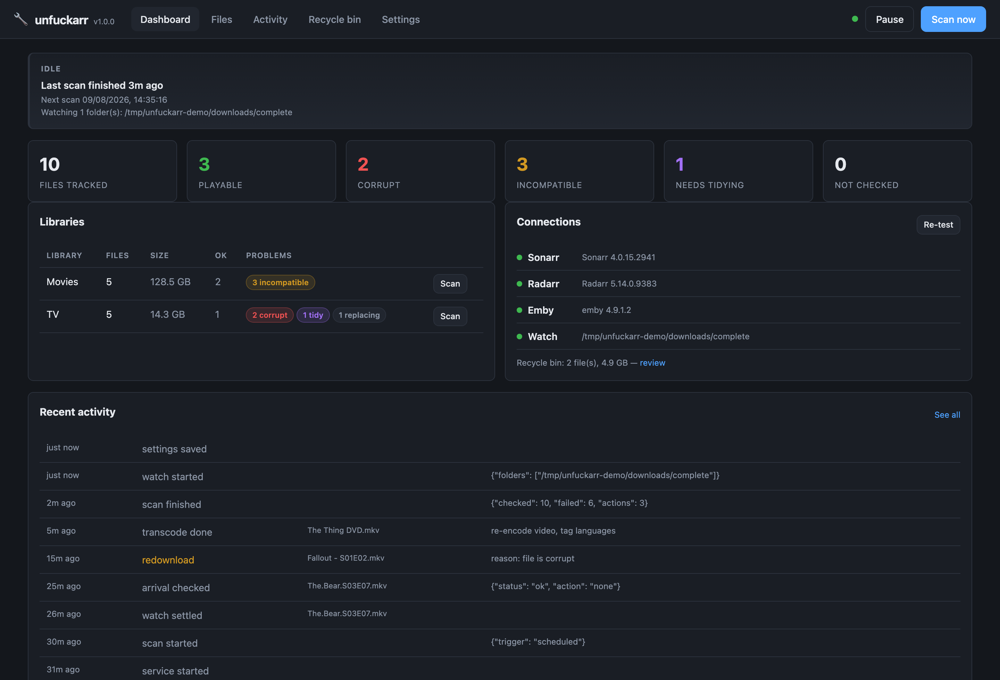
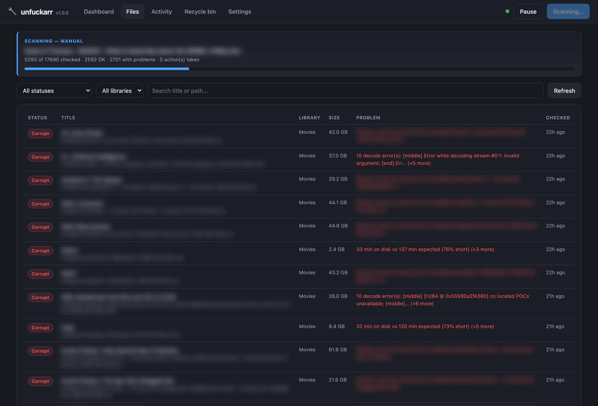
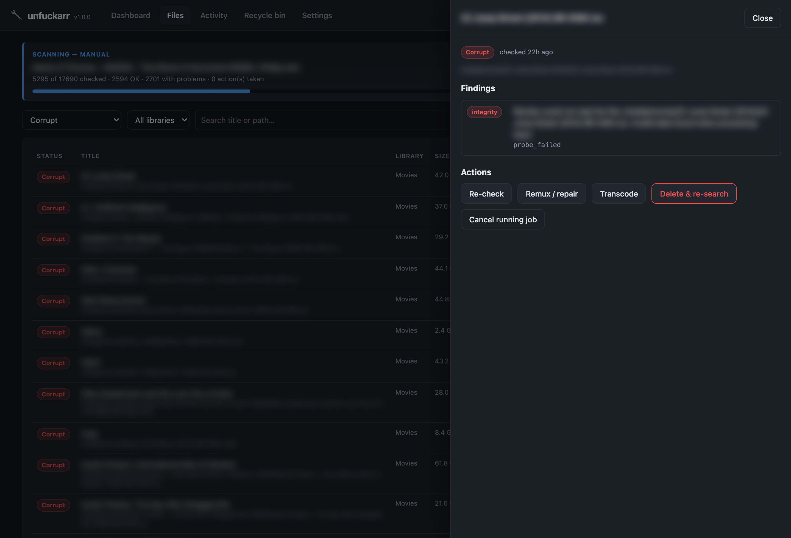
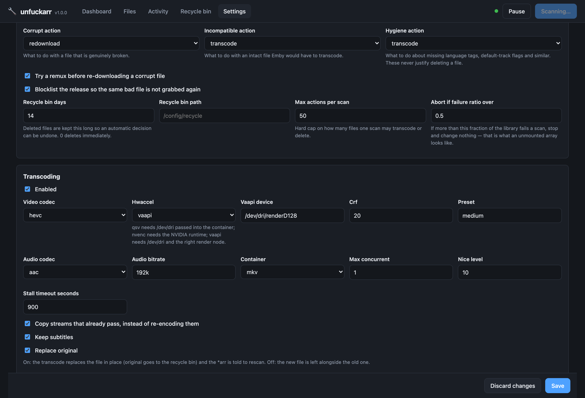

# unfuckarr

> [!WARNING]
> **unfuckarr is designed to run purely inside a [Tailscale](https://tailscale.com) tailnet (or
> another private network you trust end to end). Do not expose it to the public internet.**
> It's a service that deletes and rewrites media files unattended, its API has no
> authentication until you set a key, and its security has **not** been independently reviewed
> by a human. Bind it to your tailnet with `UNFUCKARR_BIND_INTERFACE=tailscale0` (see
> [Binding to an interface](#binding-to-an-interface)), set an API key, and keep it off the
> open internet. No reverse proxy, no port forward, no "it's fine, it has a password".

> **AI-assisted project.** This codebase was created with [Claude](https://claude.com/claude-code)
> (Anthropic), directed and reviewed by a human author.
> The check engine, the transcode planner, the policy brakes and the recycle bin are covered by a
> test suite that runs against real files rendered by ffmpeg on every push. Since 1.0.0 it's
> been used live too: I've connected it to a real Sonarr, Radarr and Emby setup and run real
> repairs (remuxes, recycling, delete-and-re-search) against a live 17,000-file library.
> The only hardware encoder that's been run is `vaapi`, on an AMD Radeon 880M (see
> [Hardware transcoding](#hardware-transcoding)). `qsv`, `nvenc` and `videotoolbox` haven't run
> on real hardware, and the Unraid template install still hasn't been exercised. On *your*
> library, start with the actions set to `flag` anyway, look at what it found, and only then let
> it act.

Scans a Sonarr/Radarr library, works out which video files are broken or which ones Emby can't
direct play, and fixes them, either by transcoding, by remuxing, or by deleting the file and
asking the *arr for a better copy.

It runs as a Docker container with a web UI, and it's packaged for Unraid Community Applications.



---

## What it checks

Five independent classes of problem, each with its own remediation policy.

**Integrity: is the file actually intact?**
ffprobe refuses it, the container has no duration, there's no video or audio stream, the file is
a stub, or a decode pass over the start, middle and end produces errors. It also catches a file
that's *shorter than the runtime Sonarr or Radarr expects*, which is how you spot a truncated
download that decodes perfectly for every byte it does have.

**Emby direct play: will it play without cooking the server?**
An intact MPEG-2 AVI isn't broken. It just gets transcoded on every single play, and a weak
client fails outright. When an Emby server is configured, unfuckarr doesn't guess: it calls
`POST /Items/{id}/PlaybackInfo` with a device profile describing your target client and reads
Emby's own `TranscodeReasons` back. That takes account of your server's version, its ffmpeg build
and its remux rules in a way a local codec table never can. Without Emby, it uses a local profile
model instead: `modern`, `conservative` (Chromecast-class), `permissive`, or a custom list.

Two things Emby won't tell you. Version 4.9 says *no* without ever saying why, so when it refuses
a file the local table runs as well and supplies the reason. And it judges a file by its *default*
audio track: a DTS default with a perfectly good AC3 track beside it still transcodes on every
play. For those, unfuckarr makes the playable track the default if it's the same language with as
many channels, and otherwise adds an AC3 5.1 copy of the default in front of it, leaving the
original where it was for anything that can pass it through. A file with no playable audio at all
gets the same treatment rather than losing its DTS.

**Stream hygiene: will it behave?**
Missing audio language tags, no default track among several, image-only subtitles (which force a
video transcode whenever they're switched on), every subtitle flagged forced, odd frame rates.
None of this is breakage, so hygiene findings can never trigger a delete. The config type doesn't
allow it.

**Disc images: .iso and .img are read, not condemned.**
`ffprobe` can't open a disc image. Hand it one and it says *"Invalid data found when processing
input"*, which you can't tell apart from a properly broken file, so a library full of BR-DISKs
gets queued for delete-and-re-search. unfuckarr opens them instead, without mounting anything and
without any privilege the container doesn't already have:

- **Blu-ray** by reading the UDF filesystem in Python, taking the largest `.m2ts` under
  `BDMV/STREAM` as the feature, and handing ffmpeg its byte range through the `subfile` protocol.
  The ffmpeg in the image has no libbluray. An ffmpeg that does (on a source install, say) gets
  the disc through its `bluray:` protocol instead, which follows the disc's own playlists.
- **DVD** by parsing the ISO9660 directory in Python to find the title VOBs, then handing ffmpeg
  each one as a byte range of the image through the `subfile` protocol, which is built into every
  ffmpeg.

From there a disc is checked for integrity like any other file. Shrinking one is off by default
(`shrink_disc_images`): an encode straight out of the raw stream came out short on a live
library, and although the verification caught and discarded every one, each cost a full encode.
So a disc gets an *info* finding and is left alone; converting it with MakeMKV is below.

**Converting a disc image, with MakeMKV.** Reading an image is enough to judge it but not enough
to convert it: the feature on a Blu-ray is a *playlist* naming a sequence of segments, and taking
the largest segment instead gets you a trailer on some discs. Point unfuckarr at a MakeMKV and it
will copy the main feature out properly (stream copy, so the same video and the same lossless
audio, with the chapters and every subtitle track), put the bonus features in an `extras/` folder
beside it where Emby looks for them, and recycle the image once the result verifies. Nothing is
re-encoded. If you also want it smaller, the ordinary shrink path takes it from there, measured
at both ends like anything else.

**The menus don't survive, and nothing you use ever played them.** No Matroska file can hold a
DVD or Blu-ray menu (MakeMKV doesn't keep them either), so a conversion trades the navigation
for a file Emby can index. Emby has never rendered a disc menu; hand it an image and it picks a
title and plays it. Everything the menus were *for* (the other audio tracks, the subtitles, the
deleted scenes) comes across.

**MakeMKV isn't included, and can't be.** Its binary half isn't redistributable, and its beta
key expires roughly monthly, which isn't something an unattended service should depend on. So
`makemkv.command` is a whole command line you provide: `makemkvcon` on the PATH, or a
`docker run ... makemkvcon` shim naming a container that has it. If you use a container, mount
your media at *the same paths* it has here, or MakeMKV gets handed a path that doesn't exist and
only reports that it can't open the disc.

**An image nothing can open is reported, never condemned.** It raises an *info* finding, not an
error, and no policy acts on it. Being unable to read a file isn't evidence that the file is bad,
and this is the one place in the application where mixing those two up has already cost real
media.

**Efficiency: how small could this be, really?**
A 38 Mbps H.264 Blu-ray remux is a perfectly good file. The only thing to be said against it is
that it's four times the size of an HEVC encode nobody could tell apart from it. So every file
above a worthwhile-size floor gets *measured*. There's no bitrate threshold deciding in advance
which ones are "too big", because a threshold is a guess about how an encoder will behave on
content it hasn't seen, and it's wrong in both directions: it condemns grain-heavy 35mm that
won't compress at all, and waves through a lazily-encoded 1080p whose picture would fit in a third
of the space.

Files waiting for that measurement show as *not yet measured*, which is a statement about what's
been checked, not a claim about the file. Every one ends in one of two final states (shrunk, or
measured and left alone), and both are recorded permanently, so the backlog drains and the count
is real progress. This is the one check that isn't looking for a fault, and it's kept separate
all the way through: nothing it raises is ever an error, it can never reach a policy that
deletes, and it's left out of the failure-ratio abort below.

**Plays that fail in Emby.** A file that passes every check above and still won't play for
somebody. Emby doesn't record that anywhere, so unfuckarr listens for it through Emby's webhook
and goes and looks. See [Plays that fail in Emby](#plays-that-fail-in-emby) below.

Every file lists what's wrong with it, worst first:



…and each one opens on the findings, the actual stream layout, and the actions you can take by
hand:



## What it does about it

| Finding | Default action |
|---|---|
| Container damage only (index, atom order, bad timestamps) | Remux — seconds, lossless. Falls through to re-download if the remux fails or its output does not verify. |
| Genuinely corrupt | Delete, blocklist the release, trigger a new search |
| Intact but Emby would transcode | Transcode, copying every stream that already passes |
| Hygiene | Flag only |
| Not yet measured for a saving | Measure it, and re-encode only if the result is smaller *and* still scores at the quality target |
| A disc image nothing can open | Report it, and do nothing |
| A disc image, with MakeMKV configured | Copy the feature out to `.mkv`, bonus features to `extras/`, recycle the image |
| A finished download the *arr will not import | Open it. If nothing importable arrived: remove, blocklist, re-search. If the file is fine: flag it for a manual import and never touch it. |

Everything is configurable per class, including turning it off.

**Transcoding copies what it can.** A compatible H.264 stream in the wrong container is a remux,
not a re-encode, and getting that wrong turns twenty seconds of work into six hours. Only the
stream that actually fails gets re-encoded. The output is verified (streams present, duration
within 2% of the source) before it's allowed to replace anything.

**Blocked imports are opened, not pattern-matched.** The queue watcher won't remove a download
because of what the status message said. It opens what arrived and decides on that.
See [the download queue](#the-download-queue--imports-that-will-never-happen).

**Shrinking is measured, not guessed.** This is the only thing unfuckarr does to a file that
nothing's wrong with, so it isn't allowed to guess, either about which files to touch or about
what the result looks like. CRF isn't a quality level. It's a rate-control knob whose meaning
depends entirely on the content, and the CRF 22 that's visually lossless on a talking-heads
documentary is mush on grain-heavy 35mm. So instead of picking a number and hoping:

1. Three short samples are taken from across the file (skipping the head and tail, where logos
   and credits compress unlike anything else).
2. Each is encoded at a candidate CRF and **scored against the source with VMAF**, and a
   bisection finds the *largest* CRF (the smallest file) that still meets the target. Largest,
   not safest: a lower CRF always passes and always saves less.
3. If the projected saving doesn't clear `min_saving_pct` (default 25%), nothing is encoded.
4. After the full encode, the finished file is measured again, on the same windows, against the
   original. If it isn't actually that much smaller, or if it doesn't still score at the
   target, **the output is deleted and the original is kept**. That's a normal outcome for a
   lot of files and isn't a failure.
5. A file that's been shrunk is never shrunk again, and one that's been assessed and left
   alone isn't reassessed. Both are recorded permanently. Re-encoding an encode is a second
   generation of loss for a fraction of the saving, and re-deciding "not worth it" costs hours
   of CPU to reach the same answer.

The saving is whatever the measurement finds. A file that halves because H.264 became HEVC and
a file that halves because it was over-encoded to begin with are the same outcome as far as this
is concerned. The only questions asked are "is it meaningfully smaller" and "does it still score
at the target".

Quality tiers are VMAF 85 (*acceptable*), 92 (*good*, the default) and 95 (*excellent*). It only
produces HEVC: Emby direct play is the premise of this whole application, and shrinking into
a codec your target profile rejects would trade a size win for a file Emby has to transcode on
every play. HDR is skipped unless you ask for it, because a re-encode that loses the metadata
gives you a grey, washed-out file that still plays, which is the worst kind of failure because
nothing reports it.

> **VMAF needs an ffmpeg that has it, and no distribution ships one.** Not Debian bookworm, not
> Debian trixie, not jellyfin-ffmpeg. So the image is built on linuxserver.io's ffmpeg 8, one
> binary that does the encoding (VAAPI included) and the scoring. Running from source, unfuckarr
> looks for an `ffmpeg-vmaf` on the `PATH` before your `ffmpeg`, so you can add a libvmaf build
> without replacing your own. Without one, it falls back to ffmpeg's built-in SSIM filter and
> says so in the UI. It does catch gross quality loss, but it matches what a person sees less
> closely, so the thresholds are approximate rather than a measurement.

> **Shrinking fills the recycle bin.** The original of every shrunk file is kept for
> `recycle_bin_days` (default 14). At five shrinks a scan on a library of 40 GB remuxes, that's
> several hundred gigabytes held back from the array at any time. Lower the retention, or the
> per-scan cap, if that isn't room you have.

**Deleting goes through the *arr, not `os.unlink`.** Removing a file behind Sonarr's back leaves
the episode marked present until its next rescan. unfuckarr deletes via the API, then marks the
grab failed, which blocklists the release *and* queues a search, so the indexer doesn't hand
back the same broken file within the hour.

## The brakes

Unattended deletion needs to be wrong safely, so there are three layers:

- **Recycle bin.** Deleted and replaced files move to a dated directory and are recorded.
  Retention defaults to 14 days and you can restore any entry from the web UI. Set it to 0 to
  unlink immediately.

  **Give it a size limit too.** Retention is a promise about *time*, and after one bad night
  fourteen days of it turns, without anyone noticing, into a promise about several hundred GB.
  `recycle_bin_max_gb` is a promise about space, which is what actually runs out: set it and the
  oldest entries are pruned to make room *before* a new file is stored, so it's a ceiling rather
  than a high-water mark. 0 means no limit. A single file bigger than the whole limit is still
  kept, after everything else has been pruned for it, because refusing would turn a recoverable
  delete into a permanent one, which is the opposite of the point.

  The recycle bin page shows the total, the limit, how full it is, and (separately) anything in
  the bin that the database has no record of, because those can't be restored from the UI even
  though they're still taking up disk and still get pruned.

  **Put the bin inside your media mount.** Set `UNFUCKARR_RECYCLE_BIN_PATH` (or the Recycle bin
  field in the Unraid template) to something like `/media/.recycle`. On the same filesystem as
  the media, recycling a file is a *rename* and costs nothing; anywhere else it's a full copy of
  every deleted file. The old default, `/config/recycle`, is the wrong place for that very
  reason: on Unraid `/config` is appdata on the cache, so every recycled 40 GB remux gets copied
  onto the cache and kept there for the retention window. unfuckarr never scans its own bin, so
  it's safe to keep it inside the library. The dashboard shows where the bin actually is, and
  makes a fuss if it isn't writable.
- **Action cap.** No single scan may act on more than `max_actions_per_scan` files (default 50).
  Shrinking isn't rationed this way at all (see below), so a long re-encode can never use up
  the pass that a corrupt file is waiting on.
- **Queue brakes, separately.** The download-queue watcher has its own pair, for the same
  reasons: no more than 5 removals per pass, and an abort if more than half the queue is blocked
  at once, with a floor, because two blocked items out of two is a ratio of 100% that means
  nothing at all. And nothing is removed on the strength of a status message: see the queue
  section below.
- **Playback brakes.** A failed play is investigated, never believed: see below. What the
  investigation finds can act at most `max_actions_per_day` times a day (default 10), and never
  on a file outside the library.
- **Failure-ratio abort.** If more than half a library fails one pass, the scan stops and changes
  *nothing*. That's what an unmounted array looks like, and it's the failure mode that costs
  people their library. I don't count shrinks here, on purpose: an unmounted array produces
  integrity failures, a file ffprobe can't read never reaches the efficiency check at all, and
  counting them would trip the brake permanently on any library that's mostly H.264, which is
  most libraries.

It's all on one settings page, and every option explains what it actually does:



### A scan is two passes, and you can stop either

The first pass **checks**: it probes every file that needs it, which takes minutes to hours. The
second **repairs**: it applies what the probes decided, one job at a time, and takes as long as
the jobs do, which on a library with a backlog and a generous action cap means days to weeks. The
dashboard says which pass is running and how far through it is (`1,204 of 3,812 files with
something to do · about 3 weeks left at this rate`), with the job in flight underneath. A bar
at 100% is never the whole scan.

**Stop scan** ends the job in flight (its half-written output is removed, the file it was
working on is left just as it was, and no attempt is counted against that file), and the
scan then records where it got to and lets go. Whatever it still had to do gets found again by
the next scan, because known-bad files are always re-checked. **Restart** does the same and
starts a fresh scan the moment the old one has let go. Both are on the dashboard while a scan
runs, and the header button switches from *Scan now* to *Stop scan*.

## Pacing, not rationing

Shrinking runs **continuously**, on its own worker, for as long as the service is up. It takes
the fattest unmeasured file, measures it, acts or declines, and moves on to the next one. That's
the only shape that fits a real library: at a quarter of an hour or more per file, a nightly
batch of five takes years, and a batch big enough to matter is a scan that runs all day and
blocks everything behind it.

What stops that from ruining the server is a **governor on the GPU's video encode engine**, not a
file count. Linux reports per-process DRM engine time in `/proc/<pid>/fdinfo`; sampled over a
wall-clock interval, `drm-engine-enc` is a direct percentage. unfuckarr reads its own encoder's
share and holds it at `gpu_encode_percent` (default 50) by pausing and resuming the process, so
half the encode engine is always there for Emby.

Measured on a Radeon 880M: flat out, a 4K HEVC encode reports **958 ms of engine time per
wall-second**; `SIGSTOP` takes that to a true **0**; `SIGCONT` brings it back to **966 ms/s** and
the finished file is valid. Asked for 50% of the engine, the governor settles at **50.5%**; asked
for 25%, at **27.0%**. The two obvious metrics, `gpu_busy_percent` in sysfs and `VCN Load` in
debugfs, both read **0** throughout that same encode, so fdinfo isn't just the nicest option,
it's the only one that works.

The governor does nothing for software encodes: there's no encode engine to share, and
`nice_level` already handles being polite about the CPU. Set `only_between_hours` if you'd rather
the work only happened overnight.

## Watch folders — the live import gate

Point a watch folder at your completed-downloads directory and every new video file is checked
the moment it lands, before the *arr imports it. That's the cheapest possible time to reject
something: nothing's been imported, and Sonarr will just grab another release.

The hard part is knowing when a file has *finished* landing. A copy still in progress and an
unpacking rar look just like a truncated download if you probe them too early, so each event
starts a settle timer that resets on every further write, and the probe only runs once the size
has held steady (60s by default). `.part`, `.!qb`, `.crdownload` and friends are ignored
outright.

Unraid user shares are SMB/NFS and deliver no inotify events, so unfuckarr spots a network
mount and polls instead. Force it either way with `UNFUCKARR_WATCH_POLL=1` / `=0`.

## The download queue — imports that will never happen

There's a failure mode nothing above can see, because it never produces a file. The download
finishes, the *arr refuses to import it, and the item sits in the queue for ever. No file
appears, so the scanner has nothing to check. Nothing *failed*, so the *arr's own failed-download
handling never fires. The episode just stays missing until you notice.

unfuckarr watches the queue for that and **only** that. I've left stalled torrents, slow torrents
and stuck metadata out on purpose: they're a download-client question, tools like
[Cleanuparr](https://github.com/Cleanuparr/Cleanuparr) already handle them well on a strike
model, and two tools removing from one queue race each other. The loser's delete hits a queue id
that no longer exists, or blocklists the replacement the winner just grabbed.

**The bit that matters is telling two things apart.** A blocked import has two causes that look
identical from the queue:

- **The release is unusable:** it unpacked to nothing, it's still in a rar, it's only the
  sample, the video won't open. Another copy is the fix: remove it, blocklist the release,
  let the *arr search again.
- **The release is fine and the *arr can't place it:** it matched the series by ID, it can't
  parse the name, the destination is read-only, it isn't an upgrade on what you already have.
  Another copy blocks in just the same way. Blocklisting throws away good media and burns a
  clean release for nothing.

Every other tool in this space tells these apart by matching the status message. unfuckarr
doesn't have to guess, because opening media files is what it already does: the message only
decides whether the files are worth *looking at*, and then it looks. **Only evidence from the
files themselves can condemn a release.** A message on its own never removes anything, and when
the path doesn't resolve or the files can't be read, the answer is "could not tell", which gets
flagged and acted on by nobody.

That isn't a hypothetical distinction. On my own library, three complete 41-minute
episodes (1.3–2.0 GB each, h264 in mkv, all playing perfectly) sat blocked behind Sonarr's
*"release was matched to series by ID. Automatic import is not possible"*, which is a request for
a manual import, not a complaint about the file. The queue cleaner running alongside had already
struck all three twice on its way to deleting them.

Set the queue action to `fix` and it acts. It ships on `flag`, which classifies everything and
touches nothing, so you can read a week of its verdicts before letting it loose. The same two
brakes as everywhere else apply: a per-pass cap, and an abort if more than half the queue is
blocked at once, because that's SABnzbd or qBittorrent or the mount, not a run of bad releases.
Nothing is considered until it's been blocked for 30 minutes, since the *arrs retry imports on
their own schedule and most blocks clear themselves.

> [!IMPORTANT]
> This needs a **path mapping**. The *arr reports the download's location as its download client
> sees it (`/downloads/...`), which is rarely what unfuckarr's container sees. Add a mapping under
> the Sonarr/Radarr settings pointing that at the same files here. Often the downloads already
> sit inside the media mount, e.g. `/downloads` → `/media/downloads/complete`, so you don't need a
> new volume. Without one, every blocked download reads as "could not tell" and nothing useful
> happens.

## Plays that fail in Emby

Every check above is unfuckarr's opinion of a file. The only opinion that really counts is
whether somebody could watch it, and Emby keeps that to itself. It has no "playback failed"
event: eight months of activity log on my server held 1,650 entries, and every one was a play
starting, a play stopping, a login or a plugin update. A failure looks like a play that stops a
few seconds after it starts, and so does someone picking the wrong episode, which is the whole
difficulty. On that same server 104 of 719 plays lasted under thirty seconds, and most of those
were people browsing.

So a short play is a reason to look, and nothing more. When one comes in, unfuckarr:

1. **Reads Emby's transcoder log.** If Emby had to convert the file for the device, its ffmpeg
   wrote down what happened, and Emby throws that log away within about a day. That's why this
   runs off a webhook rather than the nightly scan.
2. **Re-checks the file**, the same check every scan runs, Emby's direct-play verdict included.
3. **Decodes the stretch where it stopped.** The ordinary check samples the start, middle and
   end; a film that dies when you resume it at forty minutes died somewhere none of those reach.
4. **Decides as it would for any other file.** A disc image gets converted, a broken file gets
   repaired or replaced, and a file that turns out to be fine gets a note saying so, with Emby's
   own error beside it if there was one. A shrink is never the answer to a film that won't start,
   and nothing is deleted on the strength of a short play alone.

This started with a real one. On 22 October four plays in Chrome failed within half an hour, none
lasting more than two seconds, and all three films behind them were Blu-ray images. Chrome can't play an ISO,
so Emby transcodes it, and Emby's own ffmpeg can't open one either: *"Invalid data found when
processing input"*, three retries, under a second. unfuckarr had two of them down as fine.
Converting them was already the fix, but they were waiting their turn at two discs a night. A disc
that has failed to play now goes to the front of that queue, whether or not the webhook is
allowed to act.

Two days later it missed two more, for a reason Emby doesn't advertise. Emby can't read a disc
image, so it doesn't know how long the film is, and it marks a film with no length as watched
the moment it stops: "played to completion", at position 0. The web player also starts a new
play session for each retry, so the stop didn't match the start it belonged to. unfuckarr now
matches a stop to the last start of the same film on the same device. It doesn't believe a
completion at position 0, so it times the play by the clock instead. Emby will still have
marked the film as watched. That's Emby's doing, so untick it in Emby.

**Setting it up.** In Emby (it needs Emby Premiere), add a webhook under *Settings →
Notifications* for **Playback Start** and **Playback Stop**, sending `application/json` to
`http://<unfuckarr>:6969/api/emby/webhook`. If you've set an API key, Emby can't send a header,
so put it in the URL: `…/api/emby/webhook?apikey=<key>`. The settings page shows the exact
address, and Emby has to be able to resolve it: if unfuckarr is tailnet-only and Emby uses your
router's DNS, the name won't resolve, so use unfuckarr's tailnet IP. The playback action ships on `fix`, because what it does is exactly what the nightly
scan would have done anyway, only sooner; set it to `flag` and it investigates, records, and
leaves acting to the scan. Every failed play and what was found is on the file's page and at
`/api/playback`.

What it can't see: a client that crashes without telling Emby it stopped sends nothing at all,
and a device that direct-plays a file and then chokes on it leaves no transcoder log, so the
answer there is often just "the file is fine".

## Install

### Unraid

Community Applications → search **unfuckarr**. Set the media path to the *same path your *arrs
use*, or fix it afterwards with path mappings in Settings.

Or add the template by hand: `unraid/unfuckarr.xml` in this repo.

### Docker Compose

```bash
docker compose up -d
```

See [docker-compose.yml](docker-compose.yml). Then open `http://<host>:6969`.

Image tags:

| Tag | Means | Architectures |
|---|---|---|
| `latest`, `1.4.0`, `1.4` | the newest release | amd64 + arm64 |
| `edge` | current `main` | amd64 only |
| `sha-abc1234` | one specific commit | amd64 (arm64 too, on releases) |

arm64 is emulated at build time and its ffmpeg has no VAAPI encoder, so there's no hardware
transcoding there. `edge` is amd64-only because building arm64 under QEMU on every push isn't
worth the minutes, which is also why `latest` never points at a `main` build.

### From source

```bash
pip install -r requirements-dev.txt
UNFUCKARR_CONFIG_DIR=./config python -m unfuckarr
```

Needs `ffmpeg` and `ffprobe` on `PATH`.

## Configuration

Everything is on the settings page and written to `/config/config.json`. Environment variables
(`UNFUCKARR_SONARR_URL`, `UNFUCKARR_SONARR_API_KEY`, `UNFUCKARR_RADARR_*`, `UNFUCKARR_EMBY_*`,
`UNFUCKARR_WATCH_FOLDERS`, `UNFUCKARR_API_KEY`, `UNFUCKARR_PORT`) seed it and **override the saved
file on every start**, so set them once to bootstrap and then remove them. `UNFUCKARR_HOST` and
`UNFUCKARR_BIND_INTERFACE` (below) control the bind address and are env-only.

### Binding to an interface

By default the server binds `0.0.0.0`, which is every interface it can see. Two variables narrow
that:

- `UNFUCKARR_HOST`: a literal address to bind, e.g. `100.64.0.5`.
- `UNFUCKARR_BIND_INTERFACE`: an interface *name*, e.g. `tailscale0`. Its IPv4 address is
  looked up at start, so the binding survives the address changing. Startup **waits** for the
  interface to appear (60 s, tune with `UNFUCKARR_BIND_WAIT`) and then fails rather than
  falling back to `0.0.0.0`, because a VPN that comes up a few seconds late mustn't mean a
  service that's briefly listening everywhere. Takes precedence over `UNFUCKARR_HOST`.

This is how you pin unfuckarr to a [Tailscale](https://tailscale.com) tailnet permanently:
`UNFUCKARR_BIND_INTERFACE=tailscale0` and it's unreachable except through Tailscale, even from
the LAN.

Neither variable appears on the settings page, and I've done that on purpose: the bind address
is used before the web server exists, and a wrong value saved through the UI would take down
the very UI you'd use to fix it. Set them where the container is configured, in the compose
file or the container's edit page on Unraid.

The Docker catch: a process can only bind an interface that exists inside its own network
namespace. In the default bridge network the container can't see the host's `tailscale0`, so
there you control exposure from the host side instead, by publishing the port on the tailscale
address (`"100.64.0.5:6969:6969"` in `docker-compose.yml`'s `ports`). `UNFUCKARR_BIND_INTERFACE`
is for the setups where the interface really is in the container: `network_mode: host`, a
Tailscale sidecar container sharing the network namespace, Unraid's per-container Tailscale
toggle (Edit container → enable Tailscale, which runs `tailscaled` inside the container, so
`tailscale0` is there to bind), or a source install.

**Path mappings are the thing that goes wrong.** Sonarr reports `/tv/Show/S01E01.mkv`; if this
container mounts the same file at `/media/tv/...`, every lookup misses and the whole library reads
as missing. Either mount media at the same path the *arrs use, or add `/tv = /media/tv` under the
relevant service in Settings.

### Hardware transcoding

Pass `/dev/dri` into the container and set the accelerator in Settings → Transcoding:

| Setting | Needs |
|---|---|
| `qsv` | Intel iGPU, `/dev/dri` passed through |
| `vaapi` | `/dev/dri`, correct render node (`vaapi_device`) |
| `nvenc` | NVIDIA container runtime |
| `videotoolbox` | macOS host, source install only |

The amd64 image's ffmpeg brings its own VA drivers (radeonsi for AMD, iHD and i965 for Intel).
**The arm64 build has no `hevc_vaapi` encoder at all**, so there's no hardware transcoding on ARM.

**`vaapi` is tested on real hardware**, an AMD Radeon 880M (gfx1150), where a 1080p MPEG-2
source re-encodes to HEVC at about 12× realtime through unfuckarr's own transcode path. That
run needed Mesa from bookworm-backports, because Debian's stable Mesa knows no AMD GPU newer
than RDNA2 and fails with `amdgpu: unknown (family_id, chip_external_rev)` on anything newer,
with the card sitting right there in `/dev/dri`. Since v1.2.0 the image takes its ffmpeg and VA
drivers from linuxserver.io's ffmpeg 8 build instead, and that has run on the same card too:
correct 1080p output, scoring VMAF 91.65 on a QP 26 encode.

`qsv`, `nvenc` and `videotoolbox` are still command-line construction only. No Intel, NVIDIA or
macOS hardware has run them. `none` (libx264) is still the default.

Hardware *decode* isn't required and isn't requested: the file is decoded in software
and uploaded to the GPU for encoding. The sources this tool exists to fix are often ones modern
GPUs don't decode at all any more (no recent AMD part has an MPEG-2 decoder), and asking the GPU
to filter frames it never decoded fails partway through the file rather than at startup.

## Development

```bash
python -m pytest tests -q
```

The suite renders real clips with ffmpeg rather than mocking the probe, because the interesting
bugs are in what ffmpeg actually says about a file. Tests that need ffmpeg skip cleanly without it.
The *arr and Emby clients are tested against `httpx.MockTransport`.

The screenshots above are captured from a live instance mid-scan of a real library, with
anything naming real media blurred at capture time. To work on the UI without three real
servers, there's a demo pipeline, where `demo_services.py` stands in for Sonarr, Radarr and Emby:

```bash
python scripts/demo_services.py &
UNFUCKARR_CONFIG_DIR=./demo python scripts/seed_demo.py --with-services
UNFUCKARR_CONFIG_DIR=./demo python -m unfuckarr
```

`demo_services.py` is a real HTTP stub answering the handshake endpoints, so the connection panel
going green means the client code actually worked, not that a flag got set.

## API

The whole UI runs on the JSON API at `/api`, documented at `/api/docs`. Set an API key in Settings
to require `X-API-Key` (or `?apikey=`) on every call. Unset means no auth, which is only tolerable
because the service is assumed to be reachable from inside your tailnet and nowhere else. It's a
brake against accidents, not a security boundary. See the warning at the top.

## Licence

MIT, see [LICENSE](LICENSE).

*Not affiliated with Sonarr, Radarr, or Emby.*
